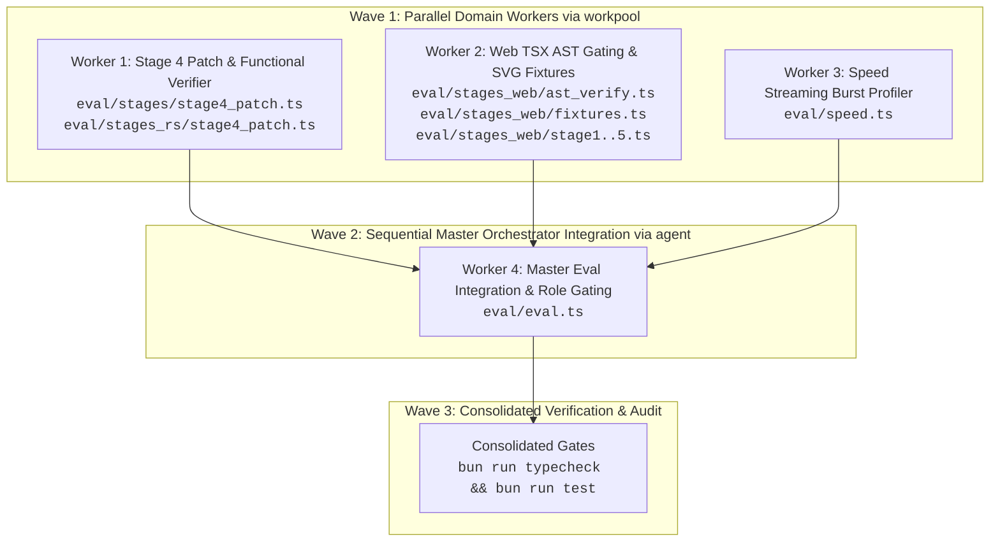

# LiteRouter Eval Gauntlet Methodological & Implementation Upgrades

## Context
LiteRouter's evaluation suite (`eval/`) tests agentic coding models and web generation in native Bun without heavyweight sandboxes. An empirical review of reports in `eval/reports/` against `eval/` stage implementations identified six methodology flaws:
1. Valid code patches in Stage 4 (`eval/stages/stage4_patch.ts` and `stages_rs/stage4_patch.ts`) are capped at 75/100 because `EXPECTED_OLD_STR` penalizes models that omit comment boundary lines (`// TARGET SCOPE START/END`), while `new_str` is never checked for functional correctness or syntax.
2. Web stages 1–5 lack syntax verification, permitting malformed TSX with unclosed tags or syntax errors to pass purely on superficial regex keyword matches.
3. Web stages 1, 2, and 5 attach image URLs (`tablequery.png`) on Chat and Messages wires while dropping them on the Responses wire, unfairly failing text-only coding models with HTTP 400. Furthermore, `eval/stages_web/fixtures.ts` references mismatched external GreptimeDB URLs (`metricchart.png`, `logsquery.png`) for pricing tables and auth modals.
4. `speed.ts` divides token count by `totalDurationMs - ttftMs` without accounting for chunk arrival spread, computing phantom throughputs up to 76,000+ tok/s when an upstream proxy dumps buffered chunks in a single TCP read.
5. `eval/eval.ts` computes fabricated `pass@k` (100.0%) across single-run executions by scaling pass fractions of disparate stages by `runs`.
6. Role classification in `eval/eval.ts` defaults to `⚡ FAST EXPLORER` even when a model fails 100% of stages or encounters upstream HTTP 403 errors.

This plan executes via deterministic `workflowz` pools in `eval` (Bun/JS), structuring the implementation into two distinct execution waves: Wave 1 parallel isolated domain workers, followed by Wave 2 master orchestrator integration, concluding with consolidated repo verification.

---

## Approach

### Workflowz Execution Architecture
Execution utilizes `eval(language="js")` with named `workpool` instances to guarantee strict isolation, bounded concurrency, and deterministic collection.



---

### Wave 1: Parallel Domain Workpool (Isolated Targets)

Initialize `workpool("task", { name: "eval-upgrades-domain-pool" })` with 3 completely file-disjoint tasks:

#### Task 1: Stage 4 Patch Indentation & Functional Correctness
- **Worker Target**: `eval/stages/stage4_patch.ts`, `eval/stages_rs/stage4_patch.ts`
- **Behavior Changes**:
  1. In `eval/stages/stage4_patch.ts`:
     - Define `EXPECTED_INNER_OLD_STR`:
       ```typescript
       export const EXPECTED_INNER_OLD_STR = `      const step = val * 2;
             this.count += step;
             this.logTelemetry("increment", step);`;
       ```
     - Update `gradeIndentation(oldStr: string)`:
       - If `oldStr.trim() === EXPECTED_OLD_STR.trim()` OR `oldStr.trim() === EXPECTED_INNER_OLD_STR.trim()`, and `oldStr.startsWith("      ")`: return `{ score: 50, status: "PASSED", fidelity: "PERFECT" }`.
       - If `TARGET_SOURCE_CODE.includes(oldStr)` without matching either exact expected scope: return `{ score: 25, status: "PARTIAL", fidelity: "TRIMMED_MATCH" }`.
       - Otherwise return `{ score: 0, status: "FAILED", fidelity: "MISMATCH" }`.
  2. In `runStage4Patch` (Sub-test 4.2 / 4.3):
     - Extract `args.new_str` from the tool call.
     - Validate functional replacement on the patched source:
       ```typescript
       const patched = TARGET_SOURCE_CODE.replace(args.old_str, args.new_str);
       const hasNewLogic = /const\s+step\s*=\s*val\s*\*\s*3\s*;/.test(patched);
       const removedOldTelemetry = !patched.includes('this.logTelemetry("increment", step)');
       const cleanSyntax = !patched.includes("@ts-ignore") && !patched.includes(": any");
       ```
     - If `!hasNewLogic || !removedOldTelemetry || !cleanSyntax`, deduct 25 points from Sub-test 4.2 score and annotate `details.functionalVerification = "FAILED: logic or syntax invalid"`.
  3. Mirror identical updates into Responses API variant `eval/stages_rs/stage4_patch.ts`.

#### Task 2: Zero-Overhead TSX AST Gating & Web Modality Resilience
- **Worker Target**:
  - `eval/stages_web/ast_verify.ts` (new)
  - `eval/stages_web/fixtures.ts`
  - `eval/stages_web/stage1_structure.ts` through `stage5_a11y.ts`
- **Behavior Changes**:
  1. Create `eval/stages_web/ast_verify.ts`:
     - Implement zero-dependency Bun native C++/Zig transpiler:
       ```typescript
       const tsxTranspiler = new Bun.Transpiler({ loader: "tsx", target: "browser" });

       export function verifyTsxCompiles(code: string): { valid: boolean; exportsCount: number; error?: string } {
         try {
           const transpiled = tsxTranspiler.transformSync(code);
           const scanned = tsxTranspiler.scan(code);
           return {
             valid: transpiled.length > 0,
             exportsCount: scanned.exports.length,
           };
         } catch (err) {
           return {
             valid: false,
             exportsCount: 0,
             error: err instanceof Error ? err.message : String(err),
           };
         }
       }
       ```
  2. In `eval/stages_web/fixtures.ts`:
     - Update `FIXTURES.pricingTable.dataUri` from `REMOTE_FIXTURE_URLS.metricChart` to `svgToDataUri(PRICING_TABLE_SVG)`.
     - Update `FIXTURES.authModalError.dataUri` from `REMOTE_FIXTURE_URLS.logsQuery` to `svgToDataUri(AUTH_MODAL_ERROR_SVG)`.
     - Retain `REMOTE_FIXTURE_URLS` constants for backwards compatibility.
  3. In `eval/stages_web/stage1_structure.ts`, `stage2_responsive.ts`, `stage3_state.ts`, `stage4_hygiene.ts`, `stage5_a11y.ts`:
     - Import `verifyTsxCompiles` from `./ast_verify`.
     - Before scoring regex patterns, run `const ast = verifyTsxCompiles(extractedCode);`.
     - If `!ast.valid`: cap the stage score at a maximum of `30/100`, mark `details.astValid = false`, and append `details.astError = ast.error`.
  4. In `stage1_structure.ts`, `stage2_responsive.ts`, and `stage5_a11y.ts`:
     - Wrap gateway query in a retry/fallback: if the initial call with image attachment returns HTTP 400 with an error indicating image input is unsupported (e.g. `does not support image inputs`, `invalid message content`, or `unsupported modality`), retry immediately with text-only prompt.
     - When fallback triggers, record `details.modality = "Text-to-UI (Vision Unsupported)"` and proceed to grade code without failing the stage.

#### Task 3: Speed Benchmark Streaming Burst Guard
- **Worker Target**: `eval/speed.ts`
- **Behavior Changes**:
  1. In `eval/speed.ts` (`BenchResult` interface):
     - Add `buffered?: boolean;`
     - Add `chunkCount?: number;`
  2. In `runSingleBenchmark`:
     - Track `chunkCount` during SSE streaming read loop.
     - Measure token distribution: track if `maxChunkTokens / totalTokens > 0.8` when `chunkCount <= 2`.
     - If burst delivery is detected:
       ```typescript
       result.buffered = true;
       result.chunkCount = chunkCount;
       // Compute throughput over total wall-clock duration rather than (total - ttft)
       const generationTimeSec = result.totalDurationMs / 1000;
       result.speedTokPerSec = generationTimeSec > 0
         ? Math.round((result.totalTokens / generationTimeSec) * 10) / 10
         : 0;
       ```
  3. In `formatSpeedRow` / aggregate table display:
     - Append `[BUFFERED]` indicator next to `tok/s` when `result.buffered` is true.

---

### Wave 2: Sequential Master Orchestrator Integration

Spawn single integration worker via `agent()`:

#### Task 4: Master Role Gating, Pass Rate Correction & Report Generation
- **Worker Target**: `eval/eval.ts`
- **Dependencies**: Consumes interfaces established in Wave 1.
- **Behavior Changes**:
  1. In `determineArchitecturalRole` (lines 512–616):
     - Add `🚫 REJECTED / UNVERIFIED` tier:
       ```typescript
       const totalPassed = (summary.codeSummary?.passed ?? 0) + (summary.webResult?.passedStages ?? 0);
       const hasUpstreamErrors = summary.stageErrors && summary.stageErrors.length > 0;
       const isCompleteFailure = totalPassed === 0;

       if (isCompleteFailure || hasUpstreamErrors) {
         return {
           role: "Rejected",
           badge: "🚫 REJECTED / UNVERIFIED",
           rationale: "Failed baseline capability gates, syntax validation, or encountered fatal upstream auth/transport errors across all evaluated stages. Not recommended for production agent delegation.",
           strengths: [],
           caveats: ["Zero passed evaluation stages or fatal upstream protocol rejections."],
         };
       }
       ```
     - Gate `⚡ FAST EXPLORER`: require `ttftMs > 0 && ttftMs < 2500 && tokPerSec >= 25 && totalPassed >= 1`.
     - Models failing Orchestrator, General Coder, and Explorer gates fall through to `🚫 REJECTED / UNVERIFIED`.
  2. In `resolvePassCounts` and report rendering:
     - When `runs <= 1`:
       - Do NOT output `pass@k` table rows or percentage lines.
       - Render: `Stage Pass Rate: ${passedStages}/${totalStages} (${Math.round((passedStages/totalStages)*100)}%)`.
     - When `runs > 1`: compute true multi-run trial statistics only if stages were executed multiple times.
  3. Integrate `[BUFFERED]` speed notes and `modality` indicators in the generated Markdown reports in `eval/reports/`.

---

## Critical Files & Anchors
- `eval/stages/stage4_patch.ts`: lines 35–77 (`EXPECTED_OLD_STR`, `gradeIndentation`) and 220–250 (`runStage4Patch`).
- `eval/stages_web/ast_verify.ts`: new file; exports `verifyTsxCompiles` via `new Bun.Transpiler({ loader: "tsx" })`.
- `eval/stages_web/fixtures.ts`: lines 250–280; replace remote PNG URLs with `svgToDataUri(PRICING_TABLE_SVG)` and `svgToDataUri(AUTH_MODAL_ERROR_SVG)`.
- `eval/speed.ts`: lines 230–255; calculate `speedTokPerSec` with burst/buffering guards.
- `eval/eval.ts`: lines 430–448 (`resolvePassCounts`), 512–616 (`determineArchitecturalRole`).

---

## Verification

### Automated Proof Commands
1. **Compilation & Unit Tests**:
   - `bun run typecheck` (zero TypeScript errors).
   - `bun test tests/eval/` (all 182 benchmark eval grader tests pass).
   - `bun run test` (all 1,442 tests across 7 domains pass cleanly).

2. **Patch Indentation & Functional Grading Proof**:
   - Run isolated Stage 4 test with a synthetic inner-scope patch:
     ```bash
     bun eval '
     import { gradeIndentation } from "./eval/stages/stage4_patch";
     const inner = "      const step = val * 2;\n      this.count += step;\n      this.logTelemetry(\"increment\", step);";
     const res = gradeIndentation(inner);
     console.log("Inner patch grade:", res);
     if (res.score !== 50 || res.status !== "PASSED") process.exit(1);
     '
     ```
     Observable output: `Inner patch grade: { score: 50, status: "PASSED", fidelity: "PERFECT" }`.

3. **Bun.Transpiler TSX Syntax Gating Proof**:
   - Run isolated transpiler check on valid vs malformed TSX:
     ```bash
     bun eval '
     import { verifyTsxCompiles } from "./eval/stages_web/ast_verify";
     const valid = verifyTsxCompiles("export default function App() { return <div className=\"flex\">Hello</div>; }");
     const invalid = verifyTsxCompiles("export default function App() { return <div className=\"flex\">Hello; }");
     console.log("Valid TSX:", valid.valid, "Invalid TSX:", invalid.valid);
     if (!valid.valid || invalid.valid) process.exit(1);
     '
     ```
     Observable output: `Valid TSX: true Invalid TSX: false`.

4. **Role Classification Rejection Proof**:
   - Test `determineArchitecturalRole` with zero passed stages:
     ```bash
     bun eval '
     import { determineArchitecturalRole } from "./eval/eval";
     const role = determineArchitecturalRole({ codeSummary: { passed: 0, results: [] }, webResult: { passedStages: 0, stages: [] }, stageErrors: ["HTTP 403 Forbidden"] });
     console.log("Role badge:", role.badge);
     if (role.badge !== "🚫 REJECTED / UNVERIFIED") process.exit(1);
     '
     ```
     Observable output: `Role badge: 🚫 REJECTED / UNVERIFIED`.

---

## Assumptions & Contingencies
- **Assumption 1**: `Bun.Transpiler` is available in Bun runtime >= 1.0 (currently running Bun 1.3+ on Linux x64).
  - *Fallback*: If `Bun.Transpiler` is unavailable, fall back to regex-based tag-balancing verification without external dependencies.
- **Assumption 2**: Text-only models encountering image payloads consistently return HTTP 400 with a descriptive error string.
  - *Fallback*: If the error message does not match known image rejection patterns, inspect HTTP status code: any HTTP 400 on initial image query triggers the text-only fallback retry before failing.
